  <!-- Dynamic Animated SVG Hero Header -->
  

  <!-- Animated Real-Time Typewriter -->
  

    
  

  <!-- Animated Ambient Laser Divider -->
  

 

### ⚡ About & Engineering Focus

Software engineer with a deep emphasis on **modern full-stack architecture**, **user-centric interfaces**, and **reliable automated deployments**. Experienced in designing type-safe frontend systems, modular API services, and resilient background synchronizations.

- 🔭 **Building**: Production-grade web applications leveraging Next.js (App Router), React, TypeScript, and modern backend pipelines.
- ⚙️ **Architecture**: Focused on clean separation of concerns, zero-layout-shift UI, and high-efficiency data transfers.
- 🚀 **Automation**: Designing resilient CI/CD workflows, automated asset pruning, and robust production delivery scripts.
- 💬 **Collaborations**: Open to discussing web architecture, performance engineering, and full-stack solutions.

 

  

 

### 🛠️ Technical Ecosystem & Toolchain

<table>
  <tr>
    <td align="left" width="30%"><strong>Frontend & UI</strong></td>
    <td align="left">
      
    </td>
  </tr>
  <tr>
    <td align="left" width="30%"><strong>Backend & Database</strong></td>
    <td align="left">
      
    </td>
  </tr>
  <tr>
    <td align="left" width="30%"><strong>DevOps & Workflow</strong></td>
    <td align="left">
      
    </td>
  </tr>
</table>

 

  

 

### 🎮 Contribution Activity (Snake Animation)

<!-- The snake below is dynamically generated via GitHub Actions (.github/workflows/snake.yml) -->

  <picture>
    <source media="(prefers-color-scheme: dark)" srcset="https://raw.githubusercontent.com/rnuranu/rnuranu/output/github-contribution-grid-snake-dark.svg">
    <source media="(prefers-color-scheme: light)" srcset="https://raw.githubusercontent.com/rnuranu/rnuranu/output/github-contribution-grid-snake.svg">
    
  </picture>

 

  

 

### 📊 GitHub Analytics & Performance Metrics

  
  

 

  

 

  

 

  
<strong>🔍 Engineering Architecture & Workstation Specifications (Click to expand)</strong>

   
  
  - **Core Paradigms**: Modular architecture, reactive state management, asynchronous stream processing, declarative UI.
  - **Frontend Philosophy**: Minimal re-renders, component atomic reusability, server/client boundary optimization.
  - **Deployment & Infra**: Automated CI/CD pipelines, incremental FTP/SSH synchronization, CSF firewall and rate-limit mitigation strategies.
  - **Primary Environment**: macOS (Darwin x64) • zsh • Git CLI • Modern Chromium & WebKit runtimes.

 

---

  <!-- Connect Badges -->
  
  &nbsp;
  
  &nbsp;
  

    
  Crafted with engineering rigor &amp; precision • Designed for dark &amp; light GitHub interfaces

